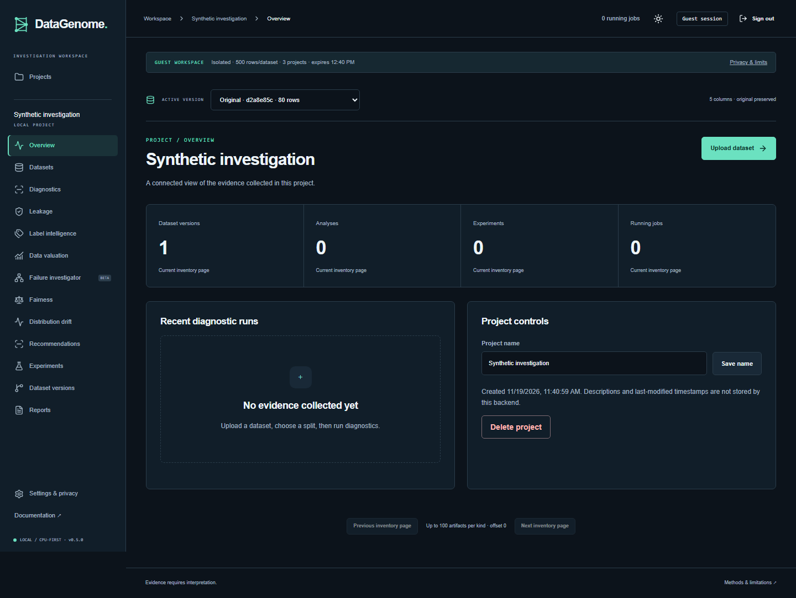

# DataGenome

Debug the data, not just the model.

## Self-hosting preview — 0.7.0

Phase10 adds tested Linux amd64 Compose deployment, validated production settings,
session/browser hardening, offline backup/restore and interrupted-job recovery.
Start with [self-hosting](docs/self-hosting.md) and the [verification matrix](docs/phase-10.md).
The default deployment stays on localhost. Residual container advisories and
operational limits remain; public internet security is **not verified**.
Scientific validation remains **partial**, with the Phase9 research results preserved.

DataGenome profiles local CSV datasets and reports observations that can help explain model
failures. The profiler measures data properties and identifies issues for review. Finding counts
are computed from the input. The class imbalance assessment uses a heuristic threshold.

## Research toolkit — 0.6.0

Phase9 adds frozen CPU benchmark protocols, safer overlap-aware holdout receipts,
forward-only chronological feature scoring, and traceable research evidence in
the web application. Read the [technical report](research/technical-report.md),
[executed results](research/results.md), [trial tables](benchmarks/results/phase9/summary.md),
and [reproduction guide](research/reproducibility.md). Findings include neutral and
negative intervention outcomes; no guaranteed accuracy improvement is claimed.

```powershell
python -m datagenome benchmark --suite smoke --output .datagenome/research/smoke
```

Broader scientific validation remains partial; see [explicit limitations](research/threats-to-validity.md).

## Web application — local preview 0.6

A connected investigation workspace now lives in `frontend/`: isolated guests or
local accounts → CSV registration → diagnostics → evidence review → explicit
corrections/exclusions → derived versions → validation experiments → report export.
All analytical findings come from the Python backend. No paid services are used.



Install Python 3.11+ and Node 24 LTS. In Windows PowerShell:

```powershell
python -m pip install ".[api,dev]"
npm --prefix frontend ci
python -m uvicorn datagenome.api:app --host 127.0.0.1 --port 8765
# In a second terminal:
npm --prefix frontend run dev
```

Open `http://127.0.0.1:3000/demo` for an isolated, backend-computed synthetic workflow.
For the optimized frontend: `npm --prefix frontend run build`, then
`npm --prefix frontend start`. The supplied commands disable Next.js telemetry.
Keep both services on loopback; internet-facing deployment is not certified.

See the [installation, user workflow and frontend architecture guide](docs/web-application.md),
[API contract](docs/frontend-integration.md), [security model](docs/security.md),
and [verified screenshots](docs/screenshots/README.md).

## Install

Python 3.11 or newer. From the repository root on Windows PowerShell:

```powershell
python -m venv .venv
.\.venv\Scripts\python -m pip install ".[api]"
```

Install `.` for the CLI alone. You can also run `python -m datagenome` from the activated environment. The original profiler uses the Python standard library. Phase 1 adds NumPy and scikit-learn for anomaly detection and model baselines.
The optional API uses FastAPI (MIT) and Uvicorn (BSD-3-Clause), which are compatible
with the project's Apache-2.0 license.

## Run the reproducible demonstration

```powershell
python examples/generate_demo.py demo.csv
.\.venv\Scripts\python -m datagenome --help
.\.venv\Scripts\python -m datagenome --version
.\.venv\Scripts\python -m datagenome profile demo.csv
.\.venv\Scripts\python -m datagenome profile demo.csv --target label --output report.json
```

Seed 42 produces 20 base records plus one copy of the first record. Expect two blank
measurements, a constant batch feature, and 20 majority labels versus one minority label.

## API

```powershell
.\.venv\Scripts\python -m uvicorn datagenome.api:app --host 127.0.0.1 --port 8765
curl.exe http://127.0.0.1:8765/health
curl.exe http://127.0.0.1:8765/version
$dgLogin = Invoke-RestMethod -Method Post -Uri "http://127.0.0.1:8765/api/v1/auth/guest" -SessionVariable dgSession
Invoke-RestMethod -Method Post -Uri "http://127.0.0.1:8765/api/v1/datasets/profile?filename=demo.csv&target=label" -ContentType "text/csv" -InFile demo.csv -WebSession $dgSession -Headers @{ "X-CSRF-Token" = $dgLogin.csrf_token }
```

The profile endpoint accepts a raw CSV body and a required `filename` query parameter.
Use `target` to count classification labels. Input failures return a JSON error code
and message with status 413, 415, or 422. The default input limit is 5 MiB. Set
`DATAGENOME_MAX_BYTES` for the API or pass `--max-bytes` to the CLI.

## Architecture and limits

The CLI and API share a CSV parser, immutable dataset representation, profiler, and
structured findings. The parser accepts comma-separated UTF-8 with an optional BOM.
Headers must be unique and nonblank. Blank physical lines are ignored. Whitespace-only
cells count as missing. Duplicates and distinct counts use exact parsed text. Numeric
statistics use finite binary64 values and may round large numbers. Leading-zero integer
tokens are treated as text. A target is interpreted as categorical when supplied.
The CLI and API process each dataset in memory. Reports include label values if a target
is supplied, so handle reports with the same care as source data. The API is intended
for local use.

## Advanced diagnostics and experiments

Version 0.2 adds dataset fingerprints, reproducible splits, advanced profiling,
anomaly scores, leakage audits, classification baselines, and controlled validation
experiments. Use `python -m datagenome --help` for all commands. [Phase 1 CLI, API,
methodology and benchmarks](docs/phase-1.md).

## Research and roadmap

Phase 0 uses descriptive statistics. Future data valuation experiments can use
[OpenDataVal](https://papers.nips.cc/paper_files/paper/2023/hash/5b047c7d862059a5df623c1ce2982fca-Abstract-Datasets_and_Benchmarks.html),
a NeurIPS 2023 benchmark for comparing valuation algorithms. Phase 1 implements split-aware diagnostics and controlled validation comparisons. Attribution, drift, fairness, and a web
interface are planned. See [research references](research/README.md) for the original papers.

See [CONTRIBUTING.md](CONTRIBUTING.md) for development checks and
[SECURITY.md](SECURITY.md) for vulnerability reporting.

## Public-dataset benchmarks

Phase 2 adds an offline threshold sweep and a repeated held-out imputation comparison.
[Run and interpret the benchmark](docs/phase-2.md).

## Training label audit

Use `python -m datagenome audit-labels data.csv --target label` to rank training labels for human review. [Method, benchmark and limitations](docs/label-audit.md).

## Training record valuation

Phase 4 adds a validation-only valuation SDK, CLI and local API, plus matched data
removal comparisons with class-specific reporting. [Algorithms, usage and benchmark](docs/valuation.md).

## Model failure investigation

Analyze a validation prediction, screen error slices, or run a prespecified removal policy on an independent holdout. [Investigator and privacy options](docs/investigator.md) and [independent evaluation](docs/independent.md).

## Fairness and distribution drift

Audit supplied groups, screen potential proxies, compare datasets, and confirm exploratory error slices on a frozen holdout. [Phase 6 methodology and usage](docs/fairness-drift.md).

## Local dataset improvement workspace

Version 0.3 adds persistent projects and immutable dataset versions, reviewed training-label corrections and exclusions, diagnostic jobs and report exports. [Reproducible workflow and API](docs/platform.md) and [verified capability inventory](docs/capabilities.md).

## Local authenticated backend (0.4)

The local HTTP API now requires a revocable account or isolated guest session,
with CSRF tokens on mutations. Trusted Python and CLI workflows remain local.
Analysis and approved experiment execution use one bounded persistent worker.
See the [frontend integration contract](docs/frontend-integration.md),
[authentication and privacy model](docs/security.md), and
[Phase 7.1 verification and limitations](docs/phase-7.1.md).
This experimental release does not establish internet-facing production security.
The 0.5 web application is documented in [the web guide](docs/web-application.md).
