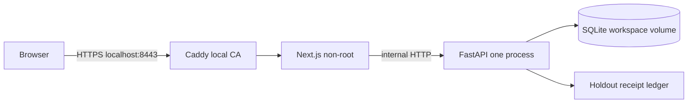

# Deployment architecture (0.7.0)

The verified target is one operator-controlled Windows x64 host, or Linux amd64
containers on Docker Desktop, bound to loopback. This is a self-hosted preview,
not an internet-security certification. See the [verification report](phase-10.md).

Only Caddy publishes a port, on 127.0.0.1. Frontend/backend networks are internal;
Caddy also has an edge network for Docker port forwarding. The backend does not
trust forwarded headers. The frontend validates public Host and Origin before
forwarding same-origin requests. No domain certificates or cloud infrastructure
are provisioned. All images have non-root users, read-only root filesystems,
dropped capabilities, explicit temporary mounts and CPU/memory/process limits.

The Python runtime is locked to 24 Linux wheel hashes. npm uses its lockfile;
base images use immutable registry digests. This pins inputs, not byte-for-byte
reproducible output: build tooling, package registries and build timestamps remain
trust dependencies. Only amd64 is tested. See [self-hosting](self-hosting.md).

SQLite schema 2 stores datasets, versions, reports and experiments together.
Do not configure replicas, multiple Uvicorn workers or independent writers.
The OS-backed workspace lease prevents overlapping service/operator ownership;
trusted direct SDK clients remain the operator's responsibility.
